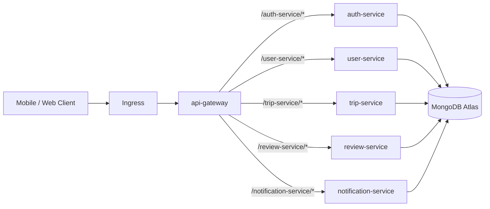
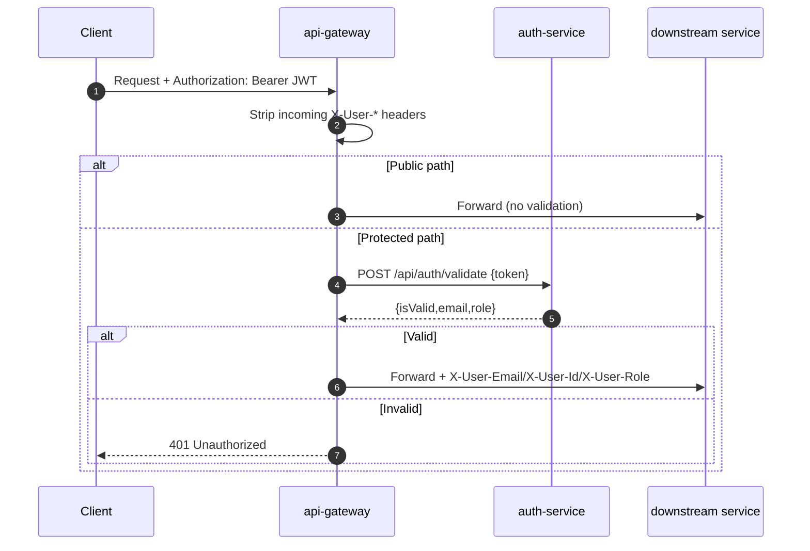
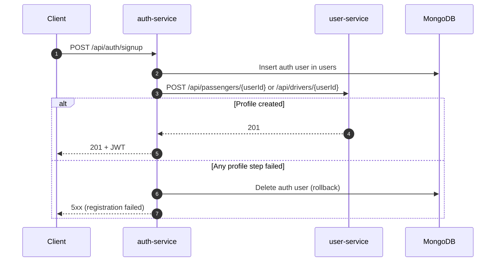
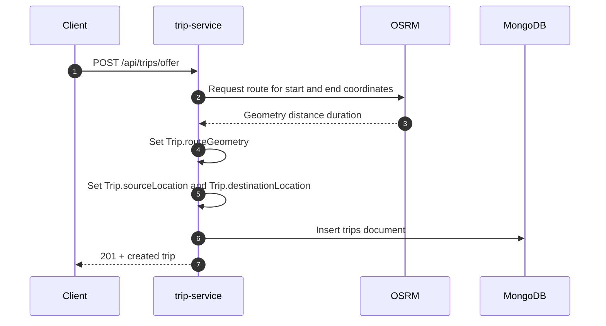
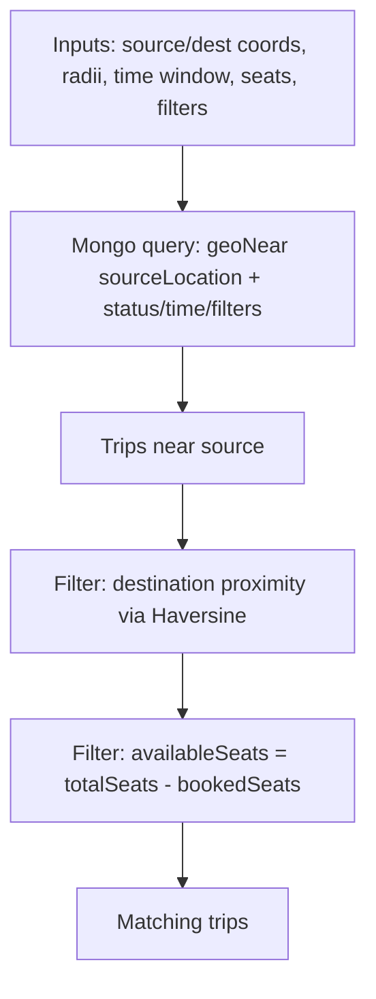
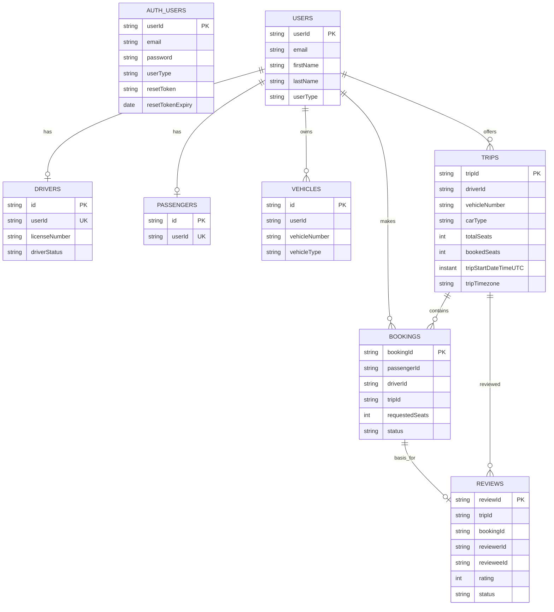
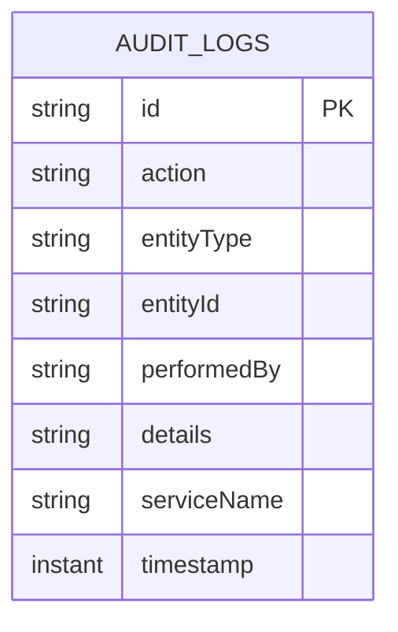

# Backend Technical Report: Carsharing Backend (Kamili Drive)

This document covers the backend technical design and quality assurance evidence for the Carsharing system.

Scope: backend only (microservices, infrastructure, database, QA). The Requirements Analysis (C1-C3) is included from a backend perspective. Client/mobile implementation details are out of scope, except for a brief development toolchain note where it impacts end-to-end integration.

Repository: `carsharing-backend`

## 1. Requirements Analysis

### 1.1 C1 — Definition of the Target System

Target system: a backend platform for a university-focused carpooling service. The backend exposes an HTTP/JSON API for a mobile client and provides end-to-end support for ride offering, ride discovery, booking management, and mutual reviews.

Backend scope (this repository):

* API Gateway as single entry point with routing, authentication validation, and admin path enforcement.
* Domain microservices: authentication, users/vehicles, trips/bookings, reviews, notifications.
* Persistence in MongoDB Atlas and operational deployment via Kubernetes (local Kind and production GKE).

Primary actors and backend responsibilities:

* Guest: access public endpoints (e.g., login/signup).
* Passenger: search trips, create bookings, cancel bookings, leave reviews.
* Driver: offer trips, manage trip lifecycle, accept/reject bookings, cancel trips, leave reviews.
* Admin: perform moderation/reporting actions and query audit logs.

Evidence:

* High-level project goal: `README.md`.
* Core user journeys: `.docs/product/user-flows.md`.
* Architecture overview: `.docs/technical/crucial/architecture.md`.

### 1.2 C2 — Functional Requirements

Functional requirements are stated as backend-visible capabilities (API + service responsibilities).

Authentication and identity:

* FR-Auth-1: Users can sign up and log in to obtain a JWT.
* FR-Auth-2: Protected endpoints require JWT authentication; identity is propagated to services.
* FR-Auth-3: Admin-only endpoints are protected from non-admin users.

Trip offering and enrichment:

* FR-Trip-1: Drivers can offer a trip (route, time, seats, price).
* FR-Trip-2: The system enriches offered trips with route geometry, distance, and duration via OSRM.
* FR-Trip-3: The system stores geospatial fields to enable proximity search.

Trip discovery and booking:

* FR-Search-1: Passengers can search for trips near a source location.
* FR-Search-2: The system filters candidates by destination proximity, time window, and seat availability.
* FR-Book-1: Passengers can request seats on a trip (booking lifecycle: requested, accepted/rejected, cancelled).
* FR-Book-2: Drivers can accept or reject booking requests.

Trip lifecycle:

* FR-Life-1: Drivers can cancel trips; dependent bookings are cancelled.
* FR-Life-2: Trip state transitions exist for created, in progress, completed.

Reviews:

* FR-Rev-1: Trip participants can submit reviews after completion.
* FR-Rev-2: Users can query received/given reviews and aggregated ratings.

Notifications:

* FR-Notif-1: Users receive notifications for booking and trip events.

Admin/reporting:

* FR-Admin-1: Admin can manage core entities via admin endpoints.
* FR-Admin-2: Admin can query audit logs via reporting endpoints.

Evidence:

* API catalog and example payloads: `.docs/technical/crucial/api-reference.md`, `.docs/technical/crucial/api-guide.md`.
* User flows referencing backend behavior: `.docs/product/user-flows.md`.
* Gateway enforcement: `api-gateway/.../JwtValidationFilter.java`, `api-gateway/.../AdminAuthorizationFilter.java`.
* Trip offer and geospatial matching: `trip-service/.../OfferRideService.java`, `trip-service/.../TripGeospatialService.java`.
* Audit log query endpoints: `trip-service/.../controller/ReportsController.java`.

### 1.3 C3 — Non-Functional Requirements

Non-functional requirements are described in backend- and operations-relevant terms.

Security:

* NFR-Sec-1: Authenticate requests using JWT and reject missing/invalid tokens (401).
* NFR-Sec-2: Prevent header spoofing for identity headers passed downstream.
* NFR-Sec-3: Restrict admin endpoints to admin role.

Availability and health monitoring:

* NFR-Avail-1: Provide readiness and liveness endpoints for Kubernetes probing.
* NFR-Avail-2: Deploy microservices with resource requests/limits.

Scalability:

* NFR-Scale-1: Services run behind Kubernetes Services for load balancing; HPAs exist (even if min=max in current manifests).

Observability and auditability:

* NFR-Obs-1: Correlate requests end-to-end using `X-Request-Id`.
* NFR-Obs-2: Expose Prometheus metrics and integrate with monitoring stack.
* NFR-Audit-1: Persist immutable audit logs for significant state changes.

Data consistency:

* NFR-Data-1: Cross-service operations should avoid partial failures where feasible (e.g., signup rollback pattern).

Maintainability:

* NFR-Maint-1: Modular services with shared `common` module for cross-cutting concerns.

Evidence:

* JWT validation and header stripping: `api-gateway/.../JwtValidationFilter.java`.
* Admin path enforcement: `api-gateway/.../AdminAuthorizationFilter.java`.
* Probes/requests/limits/HPA: `gitops/base/deployments/*.yaml`.
* Monitoring via Helm: `gitops/scripts/monitoring/setup-monitoring.sh`, `.docs/technical/devops/monitoring.md`.
* Request ID: `api-gateway/.../RequestIdGatewayFilter.java`, `common/.../RequestIdFilter.java`.
* Audit logging design: `.docs/technical/crucial/audit-logging.md`, `common/.../AuditService.java`.
* Signup rollback: `auth-service/.../AuthService.registerUser(...)`.

## 2. System Design

### 2.1 D1 — High-Level Architecture

This section corresponds to D1 (High-Level Architecture) and summarizes the system structure, interfaces, and deployment model.

Evidence references are embedded throughout the following D1 subsections.

#### D1.1 Architecture Overview

The backend follows a microservices architecture deployed on Kubernetes. All external traffic enters via a Spring Cloud Gateway that routes requests by path prefix to internal services.

Key services:

| Service | Responsibility | Evidence |
|---|---|---|
| `api-gateway` | Single entry point, routing, JWT validation, admin path enforcement, request ID propagation | `api-gateway/src/main/resources/application.yml`, `api-gateway/src/main/java/.../JwtValidationFilter.java`, `.../AdminAuthorizationFilter.java`, `.../RequestIdGatewayFilter.java` |
| `auth-service` | JWT issuance (signup/login), token validation, password reset, auth user persistence | `auth-service/src/main/java/.../AuthController.java`, `.../AuthService.java`, `.../security/JwtService.java` |
| `user-service` | User profile, driver/passenger profiles, vehicles, driver documents | `user-service/src/main/java/.../model/*`, `.../vehicle/model/Vehicle.java` |
| `trip-service` | Trip offer, geospatial search, booking lifecycle, admin reports | `trip-service/src/main/java/.../OfferRideService.java`, `.../TripGeospatialService.java`, `.../model/Trip.java`, `.../model/Booking.java`, `.../controller/ReportsController.java` |
| `review-service` | Mutual reviews between drivers/passengers | `review-service/src/main/java/.../model/Review.java` |
| `notification-service` | Notifications (implementation details not covered in depth here) | module present in parent `pom.xml` |
| `common` | Shared DTOs, error handling, audit logging, request-id filter | `common/src/main/java/.../ApiResponseWrapper.java`, `.../exception/GlobalExceptionHandler.java`, `.../service/AuditService.java`, `.../filter/RequestIdFilter.java` |

##### D1.1.1 Component Diagram (Kubernetes + Gateway)

Routing is configured explicitly in `api-gateway/src/main/resources/application.yml`:

* `Path=/user-service/**` -> `http://user-service:8080` (StripPrefix=1)
* `Path=/auth-service/**` -> `http://auth-service:8080` (StripPrefix=1)
* `Path=/trip-service/**` -> `http://trip-service:8080` (StripPrefix=1)
* `Path=/review-service/**` -> `http://review-service:8080` (StripPrefix=1)
* `Path=/notification-service/**` -> `http://notification-service:8080` (StripPrefix=1)

#### D1.2 Interfaces and Communication

External interface:

* HTTP/JSON API via gateway (OpenAPI per service; gateway aggregates Swagger UI endpoints).

Internal communication:

* Gateway performs auth validation via HTTP call to `auth-service` (`POST /api/auth/validate`).
  * Evidence: `api-gateway/.../JwtValidationFilter.java` calls `serviceProperties.getAuth().getValidateUrl()`.
  * Base URL and path are configured under `gateway.services.auth` in `api-gateway/src/main/resources/application.yml`.

* `auth-service` calls `user-service` during signup to create a user profile.
  * Evidence: `auth-service/.../AuthService.java` uses `UserServiceClient.createProfile(...)`.
  * `UserServiceClient` uses Spring `RestClient` and treats `409 Conflict` as idempotent success.

#### D1.3 Security Model

Authentication:

* JWT tokens are issued by `auth-service` and presented by clients via `Authorization: Bearer <token>`.
* The gateway validates JWTs by delegating token validation to `auth-service`.
  * Evidence: `JwtValidationFilter.validateTokenWithAuthService(...)`.

Identity propagation:

* After validation, the gateway injects the following headers for downstream services:
  * `X-User-Email`
  * `X-User-Id` (currently set to `email.toLowerCase()`)
  * `X-User-Role`
  * Evidence: `api-gateway/.../JwtValidationFilter.java` lines 72-77.
* To prevent spoofing, the gateway strips any incoming `X-User-*` headers before processing.
  * Evidence: `JwtValidationFilter` lines 39-47.

Authorization:

* Admin endpoints are protected by path-based rules at the gateway.
  * Evidence: `api-gateway/.../AdminAuthorizationFilter.java` checks `gateway.security.admin-paths`.
* Services can additionally enforce admin access using `common/util/AdminGuard.requireAdmin`.
  * Evidence: `trip-service/.../ReportsController.java`.

Roles (application-level RBAC):

* The common user role enum includes: `ADMIN`, `DRIVER`, `PASSENGER`.
  * Evidence: `common/src/main/java/com/cimhub/common/enums/UserType.java`.

##### D1.3.1 Admin Endpoint Inventory (App-Level)

The following admin endpoints exist in the codebase (all under `/api/admin/...`), and are guarded in two places:

* Gateway: `AdminAuthorizationFilter` denies requests to admin paths unless `X-User-Role=ADMIN`.
  * Evidence: `api-gateway/src/main/java/com/cimhub/apigateway/filter/AdminAuthorizationFilter.java`, `api-gateway/src/main/resources/application.yml` (`gateway.security.admin-paths`).
* Service: controllers call `AdminGuard.requireAdmin(userRole)`.
  * Evidence: `common/src/main/java/com/cimhub/common/util/AdminGuard.java`.

| Service | Base path | Controller evidence |
|---|---|---|
| `user-service` | `/api/admin/drivers` | `user-service/.../controller/AdminDriverController.java` |
| `user-service` | `/api/admin/passengers` | `user-service/.../controller/AdminPassengerController.java` |
| `user-service` | `/api/admin/vehicles` | `user-service/.../vehicle/controller/AdminVehicleController.java` |
| `trip-service` | `/api/admin/trips` | `trip-service/.../controller/AdminTripController.java` |
| `trip-service` | `/api/admin/bookings` | `trip-service/.../controller/AdminBookingController.java` |
| `trip-service` | `/api/admin/reports` (incl. audit log queries) | `trip-service/.../controller/ReportsController.java` |
| `review-service` | `/api/admin/reviews` | `review-service/.../controller/AdminReviewController.java` |

##### D1.3.2 RBAC Matrix (Kubernetes vs Application)

| Layer | Principal | Scope | Permission model | Evidence |
|---|---|---|---|---|
| Kubernetes (RBAC) | `ServiceAccount spring-cloud` | Namespace `carsharing` | `Role` grants `get/list/watch` on `pods`, `services`, `endpoints` for service discovery | `gitops/base/rbac/spring-cloud-rbac.yaml` |
| Application (Gateway) | Caller with JWT | All gateway routes | Public paths bypass JWT; protected paths require token validation; admin paths require role `ADMIN` | `api-gateway/src/main/resources/application.yml`, `JwtValidationFilter.java`, `AdminAuthorizationFilter.java` |
| Application (Services) | Downstream service reading headers | Per-service endpoints | Service methods/controllers enforce role checks via `AdminGuard` using `X-User-Role` header | `common/.../AdminGuard.java`, admin controllers listed above |

Public endpoints:

* Gateway bypasses validation for configured public paths (e.g., `/auth-service/api/auth/login`, `/auth-service/api/auth/signup`).
  * Evidence: `gateway.security.public-paths` in `api-gateway/src/main/resources/application.yml`.

#### D1.4 Observability and Error Handling

Request correlation:

* Gateway ensures `X-Request-Id` exists (generates UUID if missing) and returns it in responses.
  * Evidence: `api-gateway/.../RequestIdGatewayFilter.java`.
* Services attach `X-Request-Id` to responses and store it in MDC as `requestId`.
  * Evidence: `common/.../RequestIdFilter.java`.

Error format:

* Services use a shared `GlobalExceptionHandler` returning a structured `ApiError` including `requestId`.
  * Evidence: `common/.../exception/GlobalExceptionHandler.java`.

Audit logging:

* Domain actions are recorded in MongoDB collection `audit_logs` via `common` module `AuditService`.
  * Evidence: `common/.../service/AuditService.java`, `.docs/technical/crucial/audit-logging.md`.

Audit log data model and access:

* Stored fields include: `action`, `entityType`, `entityId`, `performedBy`, `details`, `serviceName`, `timestamp`.
  * Evidence: `common/src/main/java/com/cimhub/common/model/AuditLog.java`.
* Admin can query audit logs through trip-service reporting endpoints.
  * Evidence: `trip-service/src/main/java/com/cimhub/tripservice/controller/ReportsController.java` (`/api/admin/reports/audit-logs`).

#### D1.5 Deployment Strategy (Manual GitOps)

Deployments are applied from the `gitops/` directory using a scripted, "manual GitOps" workflow.

* Rule: do not modify live cluster state via `kubectl edit/patch/delete`; change manifests and apply.
  * Evidence: `.docs/technical/devops/gitops.md`.
* Entrypoint script: `gitops/gitops.sh`.
* Uses Kustomize overlays:
  * local: `gitops/overlays/local`
  * production: `gitops/overlays/production`

Monitoring stack (Prometheus, Grafana, Loki, Fluent Bit) is installed via GitOps script and Helm.

* Evidence: `.docs/technical/devops/monitoring.md`, `gitops/monitoring/*`.

Monitoring installation details (Helm):

* Install/uninstall scripts:
  * `gitops/scripts/monitoring/setup-monitoring.sh`
  * `gitops/scripts/monitoring/teardown-monitoring.sh`
* The setup script uses Helm to install:
  * `kube-prometheus-stack` (Prometheus, Grafana, AlertManager)
  * `grafana/loki`
  * `fluent/fluent-bit`
  and applies a `ServiceMonitor` for `/actuator/prometheus` scraping.
  * Evidence: `gitops/scripts/monitoring/setup-monitoring.sh`, `.docs/technical/devops/monitoring.md`.

##### D1.5.1 Kubernetes Resource Model (Deployments/Services/HPA)

Each microservice is deployed as a Kubernetes `Deployment` with an associated `Service`.

Common baseline settings across services (examples below):

* Replicas: typically `1` (note: `notification-service` is currently `replicas: 0`).
* Resource requests/limits: `requests: 100m CPU, 256Mi` and `limits: 500m CPU, 512Mi`.
* Probes: `livenessProbe` and `readinessProbe` call Spring Boot Actuator endpoints (`/actuator/health/liveness`, `/actuator/health/readiness`).
* HPA: `autoscaling/v2` resources exist, but are configured with `minReplicas: 1` and `maxReplicas: 1`, so no horizontal scaling occurs with the current manifests.
* Kubernetes discovery RBAC: pods run with `serviceAccountName: spring-cloud`, with a namespaced `Role` allowing `get/list/watch` on `pods`, `services`, and `endpoints` (used by Spring Cloud Kubernetes discovery).

Service types:

* `api-gateway` is exposed as `NodePort` on service port `80` mapping to container port `8080`.
* Other microservices (`auth-service`, `user-service`, `trip-service`, `review-service`, `notification-service`) are `ClusterIP` services on port `8080`.

Evidence:

* `gitops/base/deployments/api-gateway.yaml`
* `gitops/base/deployments/auth-service.yaml`
* `gitops/base/deployments/user-service.yaml`
* `gitops/base/deployments/trip-service.yaml`
* `gitops/base/deployments/review-service.yaml`
* `gitops/base/deployments/notification-service.yaml`
* `gitops/base/rbac/spring-cloud-rbac.yaml`

##### D1.5.2 Ingress Configuration (Local vs Production)

Ingress is overlay-specific:

* Local: `Ingress` uses `ingressClassName: nginx` and enables CORS for localhost origins.
  * Evidence: `gitops/overlays/local/ingress-local.yaml`.
* Production: `Ingress` uses the GCE ingress class and routes all traffic to the gateway service as the default backend.
  * Evidence: `gitops/overlays/production/ingress-production.yaml`.

Consistency note:

* `gitops/base/deployments/api-gateway.yaml` defines the gateway `Service` on port `80` (target `8080`), while `gitops/overlays/local/ingress-local.yaml` routes to service port `8080`. This should be aligned (Ingress service port must match the Service port).
  * Evidence: `gitops/base/deployments/api-gateway.yaml`, `gitops/overlays/local/ingress-local.yaml`.

Practical alignment options:

* Option A: Change local ingress backend port to `80`.
* Option B: Change the gateway `Service` port to `8080`.

##### D1.5.3 Secret Management (Current State + Risk)

Services consume configuration via environment variables sourced from a Kubernetes `Secret` named `carsharing-secrets` (e.g., `MONGODB_URI`, `JWT_SECRET_KEY`, Firebase config values).

Security note:

* The repository currently contains `gitops/base/secrets.yaml` with base64-encoded secret values. Base64 is not encryption; anyone with repository access can decode these values.

Process note:

* The documented workflow expects secrets to be created from a local `.env` file (`./gitops.sh local secrets` / `./gitops.sh gcp secrets`) or from a `secrets.yaml.example` template, rather than committing real secret values.
  * Evidence: `.docs/technical/devops/gitops.md`, `.docs/technical/devops/gcp-deployment.md`.

Recommendation:

* Do not commit real secret values to Git. Prefer generating the Kubernetes `Secret` from `.env` via the GitOps scripts, or use a dedicated secret management solution such as Sealed Secrets or External Secrets (backed by a cloud secret store) to keep encrypted/managed secrets in Git.
  * Evidence for template workflow: `gitops/base/secrets.yaml.example`.

Evidence:

* `gitops/base/secrets.yaml`
* Example env injection: `gitops/base/deployments/auth-service.yaml` (`MONGODB_URI`, `JWT_SECRET_KEY`)

##### D1.5.4 Overlay Customization (Local vs Production)

Kustomize overlays modify images and a few runtime behaviors:

* Local overlay rewrites images to locally built tags and patches deployments to use `imagePullPolicy: IfNotPresent` and `strategy: Recreate`.
  * Evidence: `gitops/overlays/local/kustomization.yaml`.
* Production overlay rewrites images to GCR, patches all `Deployment` replicas to `1`, and adds GCE-specific annotations to the gateway service.
  * Evidence: `gitops/overlays/production/kustomization.yaml`.

### 2.2 D2 — Technology Inventory

Build/runtime:

| Category | Technology | Version / Notes | Evidence |
|---|---|---|---|
| Language | Java | 21 | `pom.xml` (`<java.version>21</java.version>`) |
| Framework | Spring Boot | 3.2.3 | `pom.xml` parent |
| Cloud | Spring Cloud | 2023.0.0 | `pom.xml` (`<spring-cloud.version>`) |
| API docs | springdoc-openapi | 2.3.0 | `pom.xml` (`<springdoc.version>`) |
| Build | Maven compiler plugin | 3.11.0 | `pom.xml` (`maven-compiler-plugin`) |
| Codegen | Lombok | 1.18.42 | `pom.xml` (`<lombok.version>`) |
| Testing | Mockito (inline) | 5.11.0 | `pom.xml` (`<mockito.version>`) |
| Auth | JJWT | 0.11.5 | `auth-service/pom.xml` (`jjwt-*`) |
| Notifications | Firebase Admin SDK | 9.2.0 | `notification-service/pom.xml` |
| Trip integrations | Google Maps Services | 2.2.0 | `trip-service/pom.xml` |
| DB | MongoDB Atlas | shared instance (configured via env) | `.docs/technical/crucial/architecture.md` |
| Observability | Micrometer Prometheus registry | included at parent POM | `pom.xml` dependencies |
| Tracing | Micrometer tracing (OTel bridge) + OTLP exporter | included at parent POM; OTLP endpoint configured | `pom.xml`, `api-gateway/src/main/resources/application.yml` |
| Logging | logstash-logback-encoder | 7.4 | `pom.xml` |
| Routing | Spring Cloud Gateway | reactive gateway | `api-gateway/pom.xml`, `api-gateway/src/main/resources/application.yml` |
| Platform integration | Spring Cloud Kubernetes (Fabric8) | service discovery + config integration | `*/pom.xml` dependencies (`spring-cloud-starter-kubernetes-fabric8*`) |
| Routing API | OSRM public endpoint | `https://router.project-osrm.org/...` | `trip-service/.../config/OSMClientConfig.java` |

Notes:

* Monitoring: Prometheus/Grafana/Loki/Fluent Bit are installed via Helm and described in `.docs/technical/devops/monitoring.md`.

#### D2.1 Development Environment

Backend development OS support:

* Linux
* macOS
* Windows

Backend development environment (local):

* JDK 21 and Maven (multi-module build).
  * Evidence: `pom.xml` (`<java.version>21</java.version>`).
* Docker (build container images).
  * Evidence: GitOps workflow uses Docker image build steps: `.docs/technical/devops/gitops.md`.
* Local Kubernetes cluster: Kind.
  * Evidence: `.docs/technical/devops/gitops.md` (`./gitops.sh local setup`).
* Kubernetes tooling: `kubectl` and `kustomize`.
  * Evidence: `.docs/technical/devops/gitops.md` (manual GitOps rules and commands).
* Optional local ingress access via GitOps helper.
  * Evidence: `.docs/technical/devops/gitops.md` (`./gitops.sh local ingress`).
* Optional monitoring stack installed via Helm (Prometheus, Grafana, Loki, Fluent Bit).
  * Evidence: `.docs/technical/devops/gitops.md` (monitoring subcommands), `.docs/technical/devops/monitoring.md`, `gitops/scripts/monitoring/setup-monitoring.sh`.

Client/mobile development environment (Flutter):

* Flutter SDK: `^3.8.1`
* Dart SDK: `^3.8.1`
* IDE: Visual Studio Code or Android Studio (with Flutter support)
* Code generation: `build_runner`

#### D2.2 D2 - Technologies (Core Runtime Technologies)

The following table documents the core runtime technologies used in the overall system implementation (including the Flutter client stack, as provided).

| Technology | Version | Purpose |
|---|---|---|
| Flutter | SDK `^3.8.1` | Cross-platform UI framework |
| Dart | SDK `^3.8.1` | Programming language |
| Dio | `^5.4.3` | HTTP client for REST communication |
| Flutter Riverpod | `^2.6.1` | State management and dependency injection |
| Riverpod Annotation | `^2.3.3` | Code generation support for Riverpod |
| Flutter Secure Storage | `^9.1.1` | Encrypted local storage of tokens |
| json_annotation | `^4.9.0` | Serialization annotations |
| json_serializable | `^6.7.1` | Generated JSON serialization |
| intl | `^0.19.0` | Date and time formatting |
| http | `^1.2.0` | Lightweight requests for geocoding service |
| flutter_map | `^6.0.0` | Map rendering using OpenStreetMap |
| latlong2 | `^0.9.0` | Coordinate data structures |
| geolocator | `^10.0.0` | Device location access |
| permission_handler | `^11.4.0` | Runtime permission handling |
| flutter_map_marker_popup | `^5.0.0` | Marker popups on maps |
| email_validator | `^2.1.17` | Email validation |
| dropdown_search | `^5.0.6` | Searchable dropdown UI |
| confetti | `^0.7.0` | Booking confirmation animation |

#### D2.3 Module-Level Dependencies (Maven)

Dependency versions are defined either explicitly in module `pom.xml` files or inherited via the parent BOMs (Spring Boot `3.2.3` and Spring Cloud `2023.0.0`). The list below captures notable module-level dependencies and where their versions come from.

| Module | Notable dependencies | Version source / evidence |
|---|---|---|
| `api-gateway` | `spring-cloud-starter-gateway`, `springdoc-openapi-starter-webflux-ui`, `spring-cloud-starter-kubernetes-fabric8`, `spring-cloud-starter-loadbalancer` | Managed by parent BOMs: `pom.xml`, `api-gateway/pom.xml` |
| `auth-service` | `jjwt-api`, `jjwt-impl`, `jjwt-jackson` | Explicit `0.11.5`: `auth-service/pom.xml` |
| `trip-service` | route calculation via OSRM (`WebClient`) | Implementation in `trip-service/src/main/java/com/cimhub/tripservice/service/routes/OSMRoute.java` |
| `notification-service` | `firebase-admin` | Explicit `9.2.0`: `notification-service/pom.xml` |
| `user-service` | `spring-boot-starter-web`, `spring-boot-starter-data-mongodb`, `spring-boot-starter-validation` | Managed by Spring Boot parent: `user-service/pom.xml`, parent `pom.xml` |
| `review-service` | `spring-boot-starter-web`, `spring-boot-starter-data-mongodb`, `spring-boot-starter-validation` | Managed by Spring Boot parent: `review-service/pom.xml`, parent `pom.xml` |
| `common` | shared DTOs/utilities, includes Spring starters for common types | Managed by Spring Boot parent: `common/pom.xml`, parent `pom.xml` |

### 2.3 D3 — Detailed Design

#### D3.1 Gateway: Authentication and Identity Propagation Flow

The gateway acts as a centralized authentication point.

Evidence:

* Gateway filter: `api-gateway/.../JwtValidationFilter.java`.
* Validation endpoint: `auth-service/.../AuthController.java` -> `AuthService.validateToken(...)`.

Design notes:

* `X-User-Id` is currently set to the normalized email (`email.toLowerCase()`), not a stable opaque identifier.
* The codebase contains a token blacklist model (`BlacklistedToken`) but validation does not consult it; treat logout/blacklisting as not implemented end-to-end.
  * Evidence: `auth-service/.../model/BlacklistedToken.java`, `.../repository/BlacklistedTokenRepository.java`, and `AuthService.validateToken(...)`.

#### D3.2 Auth-Service: Signup Creates Base + Role Profiles in User-Service

Signup is cross-service and attempts to keep data consistent by rolling back the auth user record if profile creation fails.

Evidence:

* Registration logic: `auth-service/.../AuthService.registerUser(...)`.
* User-service calls: `auth-service/.../UserServiceClient.java`.

#### D3.3 Trip-Service: Offer Ride, Routing, and Geo Enrichment

When a driver offers a ride, the service calls OSRM to obtain the route, stores route metadata and sets geospatial fields (`sourceLocation`, `destinationLocation`) to enable location-based search.

Notes:

* OSRM base endpoint is `router.project-osrm.org` (see `trip-service/.../config/OSMClientConfig.java`).
* OSRM encodes coordinates as `lon,lat;lon,lat` in the `driving` path segment, and the implementation requests full geometry in GeoJSON.

Evidence:

* Offer ride orchestration: `trip-service/.../OfferRideService.java`.
* OSRM client: `trip-service/.../service/routes/OSMRoute.java`, `trip-service/.../config/OSMClientConfig.java`.
* Geospatial enrichment and query logic: `trip-service/.../TripGeospatialService.java`.

#### D3.4 Trip-Service: Matching-Route Search Strategy

MongoDB does not allow multiple `$geoNear` stages in one query, so the implementation searches near the source location in MongoDB and then filters destination proximity in memory.

Evidence:

* `TripGeospatialService.findTripsMatchingRoute(...)` includes the limitation note and implementation.

#### D3.5 Standardized API Responses and Errors

Success and error bodies are standardized across services.

* Wrapper DTO: `common/.../dto/ApiResponseWrapper.java`.
* Error codes: `common/.../exception/ErrorCode.java`.
* Exception translation to `ApiError` includes `requestId` for traceability: `common/.../exception/GlobalExceptionHandler.java`.

### 2.4 D6 — Database Design (MongoDB)

#### D6.1 Storage Strategy

The backend uses MongoDB Atlas. The current approach is a shared MongoDB instance across services, with collections separated by domain.

* Evidence: `.docs/technical/crucial/architecture.md`.

Additional evidence from service configuration:

* `auth-service`, `user-service`, and `trip-service` require `MONGODB_URI` to be provided (no local default in their `application.yml`).
  * Evidence: `auth-service/src/main/resources/application.yml`, `user-service/src/main/resources/application.yml`, `trip-service/src/main/resources/application.yml`.
* `review-service` defaults to `mongodb://localhost:27017/carsharing` when `MONGODB_URI` is not set, and can switch profiles via `SPRING_PROFILES_ACTIVE`.
  * Evidence: `review-service/src/main/resources/application.yml`, `review-service/src/main/resources/application-mongodb.yml`.

#### D6.2 Collection Overview

Collections discovered via `@Document(collection = "...")`:

| Domain | Collection | Owner module | Document class |
|---|---|---|---|
| Auth | `users` | `auth-service` | `auth-service/.../model/User.java` |
| Auth | `blacklisted_tokens` | `auth-service` | `auth-service/.../model/BlacklistedToken.java` |
| User | `users` | `user-service` | `user-service/.../model/User.java` |
| User | `drivers` | `user-service` | `user-service/.../model/Driver.java` |
| User | `passengers` | `user-service` | `user-service/.../model/Passenger.java` |
| User | `vehicles` | `user-service` | `user-service/.../vehicle/model/Vehicle.java` |
| User | `driver_documents` | `user-service` | `user-service/.../model/DriverDocument.java` |
| Trip | `trips` | `trip-service` | `trip-service/.../model/Trip.java` |
| Trip | `bookings` | `trip-service` | `trip-service/.../model/Booking.java` |
| Review | `reviews` | `review-service` | `review-service/.../model/Review.java` |
| Common | `audit_logs` | `common` | `common/.../model/AuditLog.java` |

#### D6.3 Logical Data Model (Cross-Collection Relationships)

The system uses application-level references (IDs stored as strings) rather than MongoDB joins.

Notes:

* `driverId`/`passengerId` are stored as strings (in practice often the normalized email).
* `vehicleNumber` is stored in trip/booking rather than a strict reference to `vehicles.id`.

#### D6.4 Indexing Strategy

Geospatial indexes:

* Trip collection stores `sourceLocation` and `destinationLocation` as Spring Data `Point` with `@GeoSpatialIndexed(GEO_2DSPHERE)`.
  * Evidence: `trip-service/.../model/Trip.java`.
* Index creation is also enforced at startup using `MongoConfig`:
  * `sourceLocation_2dsphere`
  * `destinationLocation_2dsphere`
  * `routeGeometry_2dsphere` (see mismatch note below)
  * Evidence: `trip-service/.../config/MongoConfig.java`.

Unique indexes:

* `drivers.userId` unique
  * Evidence: `user-service/.../model/Driver.java` (`@Indexed(unique = true)`)
* `passengers.userId` unique
  * Evidence: `user-service/.../model/Passenger.java`.

Mismatch/risk to document:

* `Trip.routeGeometry` is a `String` containing serialized GeoJSON, but `MongoConfig` attempts to create a 2dsphere index on `routeGeometry`.
  * Evidence: `Trip.routeGeometry` type in `trip-service/.../model/Trip.java` and `Indexes.geo2dsphere("routeGeometry")` in `trip-service/.../config/MongoConfig.java`.
  * If route-based geospatial queries are planned, `routeGeometry` should be stored as a GeoJSON object (BSON document) rather than a string.

#### D6.5 Audit Logs (Cross-Cutting Data)

Audit logs are a cross-cutting concern recorded in the `audit_logs` collection (not a core domain relationship like Trips/Bookings/Reviews), so they are documented separately from the main logical model.

Evidence:

* Model: `common/src/main/java/com/cimhub/common/model/AuditLog.java`
* Writer: `common/src/main/java/com/cimhub/common/service/AuditService.java`
* Query (admin): `trip-service/src/main/java/com/cimhub/tripservice/controller/ReportsController.java` (`/api/admin/reports/audit-logs`)

## 3. Quality Assurance

### 3.1 E1 — Test Plan (Backend)

This section defines the intended test strategy and what exists in the repository at time of writing (no tests were executed for this report).

#### E1.1 Test Levels and Scope

| Level | Goal | Tooling (intended) | Current status |
|---|---|---|---|
| Unit tests | Validate core business logic in isolation | JUnit 5, Mockito | Present in `auth-service` only |
| Integration tests | Validate service boundaries (DB, HTTP clients) | Spring Boot Test, Testcontainers (Mongo) | Not present in repo |
| Contract/API tests | Validate request/response contracts | Springdoc + schema checks; black-box tests | Not present in repo |
| E2E (local k8s) | Validate user journeys across services | Kind + GitOps scripts + cURL scripts | Only manual examples documented |

#### E1.2 Coverage Goals (Target)

Given the system is microservice-based and security critical, suggested targets:

* Unit test coverage target: >= 70% line coverage for pure service-layer code.
* Critical paths must be covered with tests:
  * JWT validation and claims extraction (`auth-service/security/JwtService`)
  * Signup cross-service profile creation and rollback (`AuthService.registerUser`)
  * Trip offer flow including OSRM failure handling (`OfferRideService.offerRide`)
  * Trip matching-route query logic (`TripGeospatialService.findTripsMatchingRoute`)
  * Admin authorization enforcement at gateway and service level

No coverage report is produced in this repository currently; adding JaCoCo in the Maven build is a follow-up task.

#### E1.3 Test Data and Environments

* Local: Kind cluster via `./gitops/gitops.sh local setup/build/deploy`.
* Production: GKE cluster via `./gitops/gitops.sh gcp build/deploy`.
* DB: MongoDB Atlas configured via environment variables (not committed).

#### E1.4 Manual Verification Aids

API examples and payload documentation exist and can be used as the basis for automated black-box tests:

* `.docs/technical/crucial/api-reference.md` (endpoint catalog)
* `.docs/technical/testing/integration-examples.md` (cURL/JS/Python/Java)

### 3.2 E2 — Test Protocol / Test Report (Backend)

No automated test execution was performed as part of creating this report.

#### E2.1 Tests Present in Repository

| Module | Test file | Type | Covered behavior |
|---|---|---|---|
| `auth-service` | `auth-service/src/test/java/com/cimhub/authservice/AuthServiceApplicationTests.java` | Spring context | Application context loads |
| `auth-service` | `auth-service/src/test/java/com/cimhub/authservice/service/AuthServiceResetPasswordTest.java` | Unit (Mockito) | Password reset token generation and confirmation behavior |

#### E2.2 Notable Gaps

* No tests for `api-gateway` filters (JWT enforcement, admin filter, request-id propagation).
* No integration tests for MongoDB persistence or geospatial queries.
* No contract/e2e test suite tracked in CI.

#### E2.3 Planned Test Protocol Template

When tests are executed, the protocol should record:

* Commit SHA under test
* Environment (local Kind vs GKE)
* Command(s) executed (e.g., `mvn test`)
* Summary: total tests, passed, failed, skipped
* Coverage (if enabled) per module and overall
* Known limitations and deferred issues

## 4. Appendix: Key References

* Architecture: `.docs/technical/crucial/architecture.md`
* API reference: `.docs/technical/crucial/api-reference.md`
* GitOps: `.docs/technical/devops/gitops.md`, `gitops/gitops.sh`
* Monitoring: `.docs/technical/devops/monitoring.md`, `gitops/monitoring/*`
* Audit logging: `.docs/technical/crucial/audit-logging.md`
